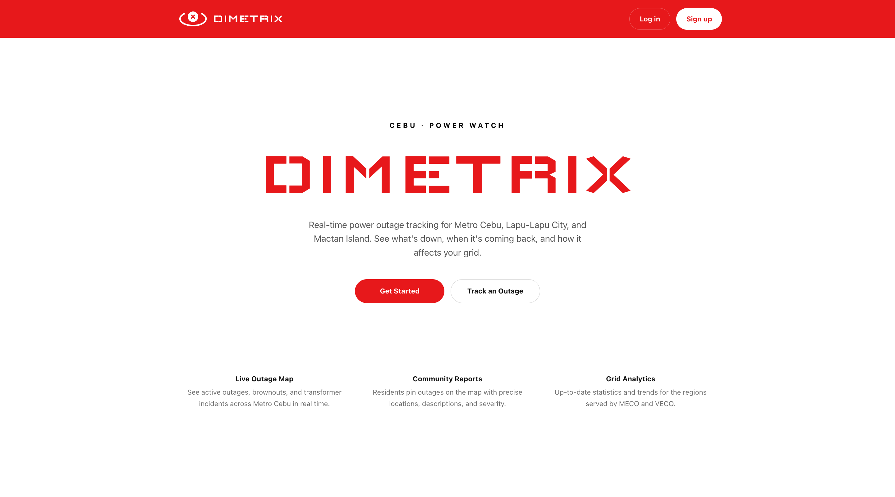
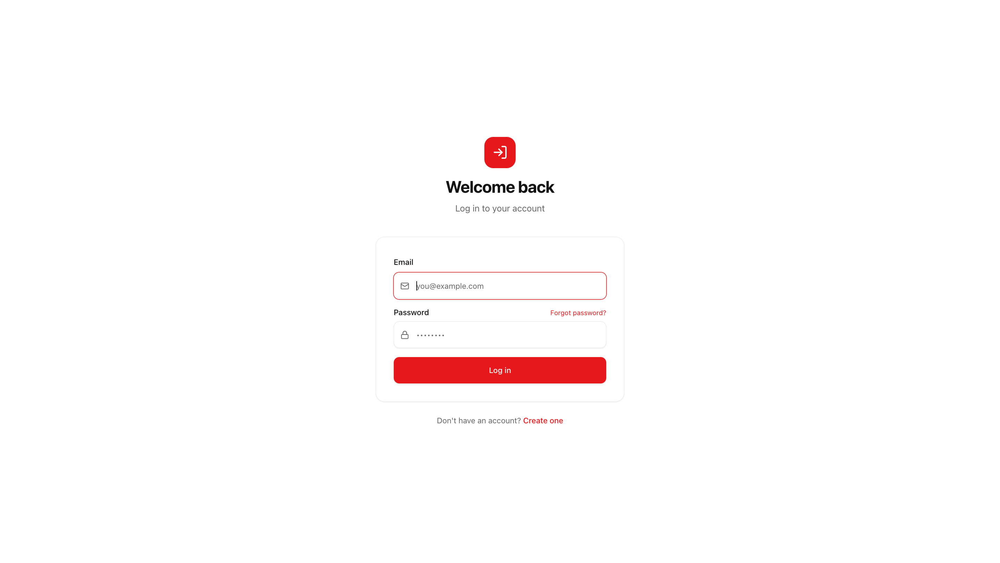
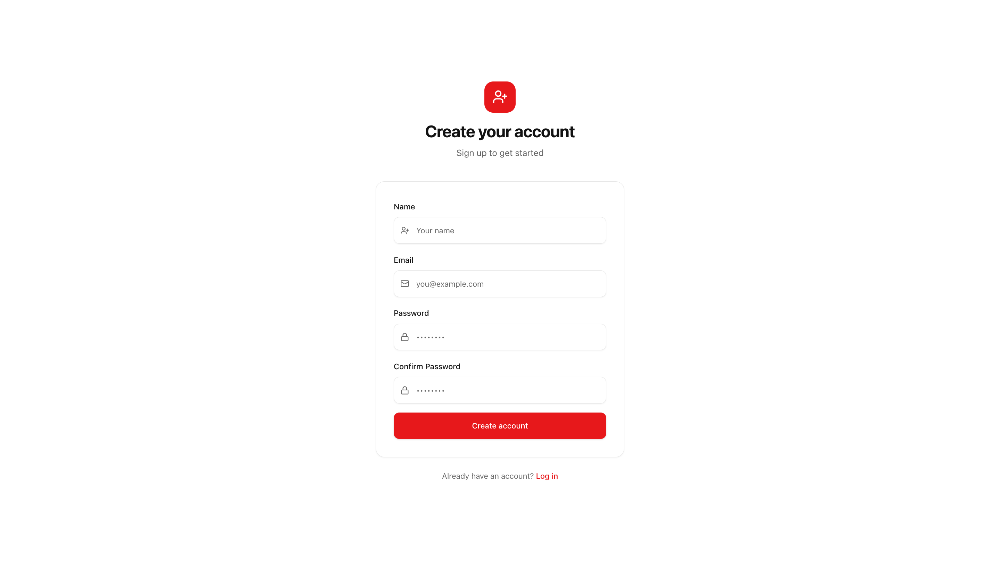
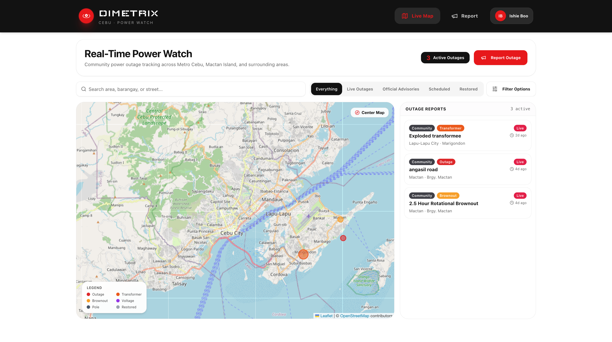
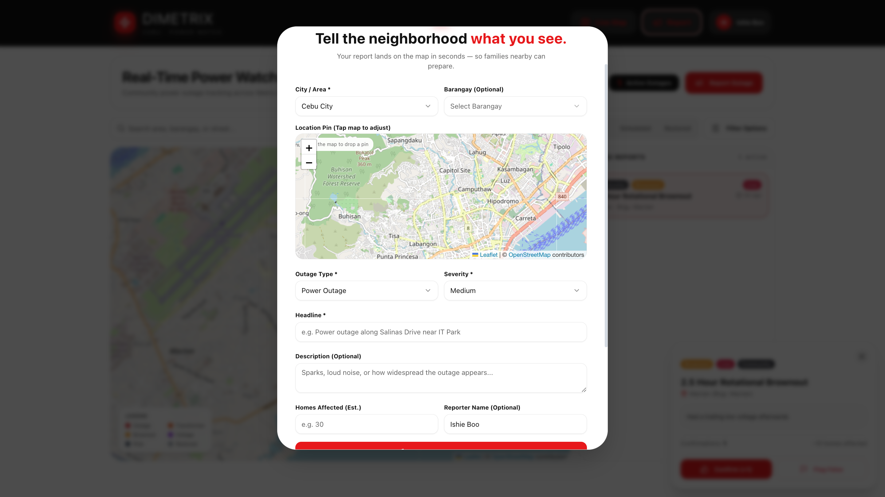
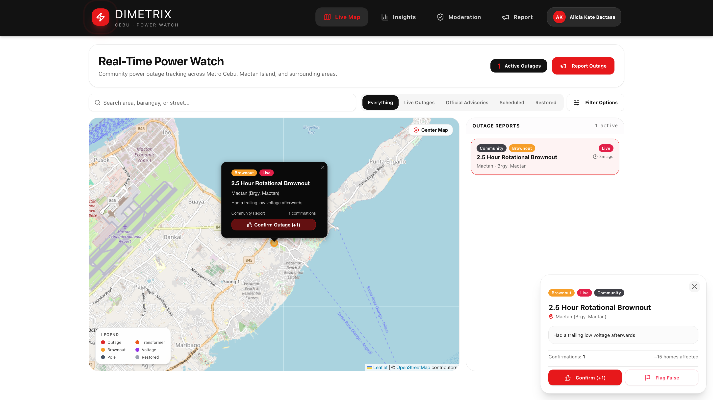
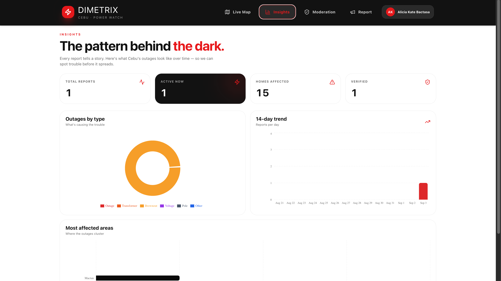
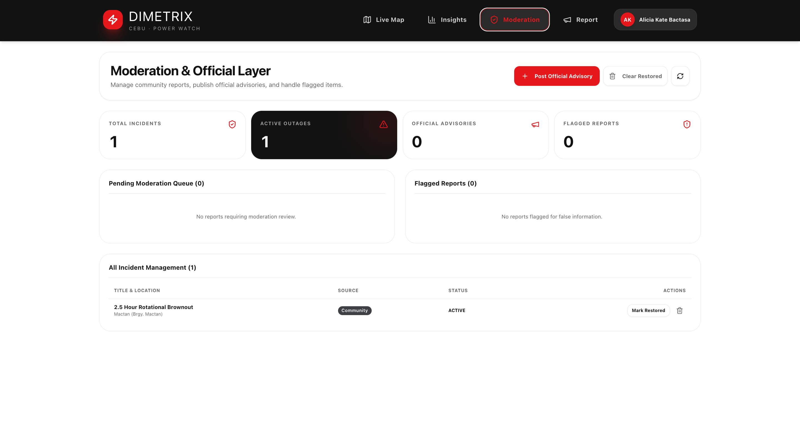

# Dimetrix — Metro Cebu Power Outage Tracker

Dimetrix is a real-time power outage tracking platform built specifically for Metro Cebu, Lapu-Lapu City, and Mactan Island. It provides residents, businesses, and local emergency teams with an interactive map of active power outages, scheduled brownouts, voltage issues, and electrical hazards.

## Website

Visit and explore the live web app:
> [dimetrix.vercel.app](https://dimetrix.vercel.app)

## Tech Stack

### Frontend


### Backend


-F22F46?style=for-the-badge&logo=twilio&logoColor=white)

### Database


-FF4438?style=for-the-badge&logo=redis&logoColor=white)

### Tools


## System Overview

Metro Cebu experiences frequent power interruptions ranging from emergency equipment trips and transformer explosions to scheduled maintenance. Before Dimetrix, residents had to rely on fragmented social media posts, busy customer hotline numbers, or word-of-mouth to find out why the power went out and when it might return.

Dimetrix unifies outage information into a single map and dashboard. Community members can report an outage in seconds by selecting their barangay or picking their exact location on the map. Other residents nearby can confirm the report, increasing confidence in the data. An administrative dashboard allows moderators to verify reports, mark restored areas, and keep the information accurate and up to date.

### Covered Areas & Utility Providers
- Visayan Electric Company (VECO): Cebu City, Mandaue City, Talisay City, Consolacion, Liloan, Minglanilla
- Mactan Electric Company (MECO): Lapu-Lapu City, Mactan Island, Cordova

## Key Features & Integrations

### Key Features
- Live Interactive Outage Map: Visualizes active, ongoing, scheduled, and restored power incidents with color-coded severity markers bounded to Metro Cebu.
- Incident Reporting: Simple form for users to report outages, blown transformers, scheduled brownouts, voltage fluctuations, or fallen poles with optional coordinates and affected household estimates.
- Community Confirmation & Flags: Neighbors can confirm an outage with one click to boost report credibility, or flag false or spam reports for admin moderation.
- Spam Detection & Duplicate Prevention: Automatic checks prevent repetitive reports in the same barangay within short time windows.
- Area & Provider Filtering: Quick filters to view reports by utility provider (VECO / MECO), city, or specific barangay.
- Outage Statistics & Charts: Visual breakdown of outages by area, severity level, incident type, and recovery progress.
- Admin Moderation: Protected dashboard for administrators to verify community reports, change incident statuses, purge restored entries, and manage users.

### Integrations
- OpenStreetMap & Leaflet: Open-source GIS tiles and coordinates without proprietary API limits.
- Neon Serverless PostgreSQL: Cloud SQL database with connection pooling for rapid serverless queries.
- Auth.js v5: Secure session handling, email/password login, and Google OAuth sign-in.
- Planned Integrations:
  - Twilio SMS / WhatsApp: Automated text notifications for urgent power outages in a user's home barangay.
  - Utility Announcement Scraper: Automated ingestion of scheduled brownout advisories from official power company notices.
  - Upstash Redis: High-speed caching for map data and distributed rate limiting.

## Repository Structure

```text
dimetrix/
├── prisma/
│   ├── schema.prisma          # Database schema for users, accounts, and incidents
│   └── seed.mjs               # Seed script with sample incidents and test accounts
├── public/
│   └── dimetrixLogo.svg       # Brand logo asset
├── screenshots/               # Application preview images for documentation
├── src/
│   ├── api/
│   │   └── apiClient.js       # Client-side API fetch wrapper
│   ├── app/
│   │   ├── (auth)/            # Auth routes: login, register, forgot-password, reset-password
│   │   ├── (dashboard)/       # App routes: map dashboard, report incident, analytics, admin
│   │   ├── api/
│   │   │   ├── auth/          # Auth.js NextAuth handler
│   │   │   ├── incidents/     # Incident CRUD, confirm, flag, and seed endpoints
│   │   │   ├── register/      # Account registration endpoint
│   │   │   └── user/          # User profile and password management endpoints
│   │   ├── globals.css        # Global CSS and Tailwind theme tokens
│   │   ├── layout.jsx         # Root HTML layout and providers wrapper
│   │   └── page.jsx           # Public landing page
│   ├── components/
│   │   ├── ui/                # Reusable UI primitives (buttons, dialogs, inputs, selects)
│   │   ├── pages/             # Page view components (Home, Login, Report, Analytics, Admin)
│   │   ├── DashboardShell.jsx # Common layout shell for logged-in pages
│   │   ├── LocationPicker.jsx # Interactive map coordinates picker for incident reporting
│   │   ├── MapView.jsx        # Interactive Leaflet map with incident markers
│   │   ├── ReportModal.jsx    # Quick outage report popup modal
│   │   └── StatCard.jsx       # Reusable KPI and count card
│   ├── hooks/                 # Custom React hooks (use-mobile, use-size)
│   ├── lib/
│   │   ├── auth.js            # Auth.js server configuration and helpers
│   │   ├── cebuAreas.js       # Metro Cebu coordinates, barangays, and provider mapping
│   │   ├── duplicateDetection.js # Heuristics to detect repetitive or spam incident reports
│   │   ├── prisma.js          # Prisma client singleton
│   │   ├── rate-limit.js      # In-memory API rate limiter
│   │   └── validations.js     # Zod validation schemas for forms and API requests
│   └── middleware.js          # Edge route protection and session redirection
├── package.json               # Dependencies and build scripts
└── tailwind.config.js         # Tailwind CSS styling and theme configuration
```

## Future Plans & Projects

- Real-Time Live Map Updates: Connect live updates using WebSockets or Server-Sent Events (SSE) so users see new outages and status changes immediately without refreshing.
- SMS & Push Alerts: Let residents subscribe to their home or business barangay to receive instant SMS (via Twilio) or browser notifications when an outage is reported.
- Utility Scraper Service: Automatically monitor and import scheduled maintenance brownout announcements directly from VECO and MECO public feeds.
- Offline-First PWA: Progressive Web App support enabling users to view recent outage maps and queue reports while cellular connectivity is weak or down.
- Restoration Time Estimator: Calculate historical averages for restoration times by incident type and location to give residents better repair estimates.

## Screenshots

<table>
  <tr>
    <td width="50%" align="center"><strong>Landing Page</strong><br><br></td>
    <td width="50%" align="center"><strong>Sign In</strong><br><br></td>
  </tr>
  <tr>
    <td width="50%" align="center"><strong>Sign Up</strong><br><br></td>
    <td width="50%" align="center"><strong>User Dashboard</strong><br><br></td>
  </tr>
  <tr>
    <td width="50%" align="center"><strong>Submit an Outage Report</strong><br><br></td>
    <td width="50%" align="center"><strong>Admin Dashboard</strong><br><br></td>
  </tr>
  <tr>
    <td width="50%" align="center"><strong>Analytics</strong><br><br></td>
    <td width="50%" align="center"><strong>Management</strong><br><br></td>
  </tr>
</table>

## Credits

- Map data & tiles: [OpenStreetMap](https://www.openstreetmap.org/)
- Icons: [Lucide Icons](https://lucide.dev/)
